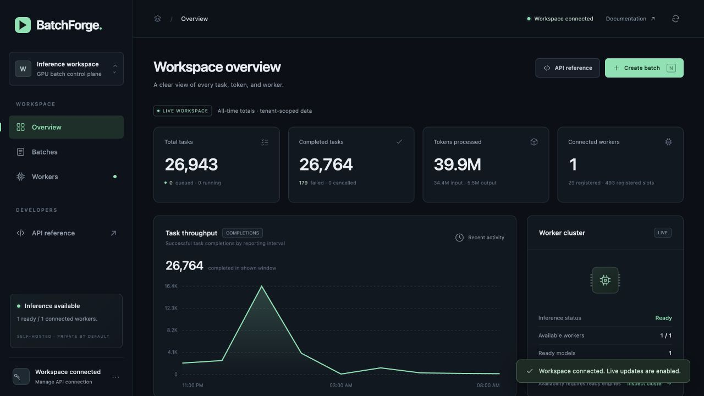
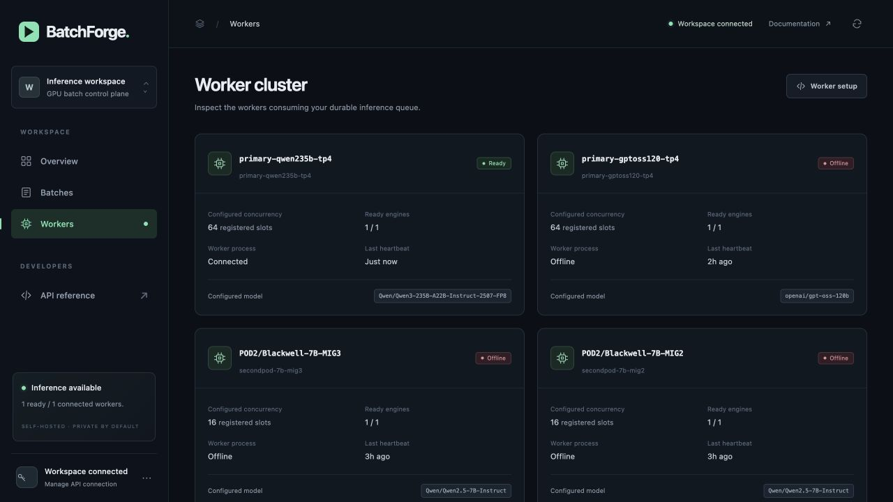

# BatchForge

Durable AI batch processing with a PostgreSQL control plane, fenced GPU workers,
an OpenAI-shaped batch API, and an operations console backed by live data.

An additive [durable Agent runtime](docs/agent-runtime.md) now implements typed
planning, capability-checked data tools, tenant memory, fenced coordinator
leases and receipt-linked model steps through the existing Batch queue.
The latest core scoring check passes1,806 Python/zero-skip and39 console tests. A
finite real480B qualification passed20/20 fresh ordered-tool Agent goals,
44 model tasks and88 artifact byte readbacks, including post-ACK coordinator
loss and API restart. Agent state used an isolated native PostgreSQL cluster;
Azure Agent-schema migration still requires owner authentication. Earlier16/20,
15/20 and8/20 failures remain preserved. [Protocol and evidence](docs/agent-schema-qualification.md).
The broader
[Agent platform implementation map](docs/agent-platform-roadmap.md) tracks
workflow composition, VectorMatch, isolation, multimodal and learning work
without presenting planned capabilities as deployed features.

The [bounded multi-Agent DAG candidate](docs/agent-workflows.md) now reserves
the whole graph atomically, fences dependency activation and cascades cancellation.
Two real480B graphs/6 Agent roles passed with14 unique model tasks, zero retries,
committed-activation coordinator loss, PostgreSQL/API restart and28 independent
input/output artifact byte reads. This is a small functional/recovery qualification,
not a throughput benchmark or an Azure Agent rollout.
[Source-bound results](docs/benchmarks/agent-dag-2026-10-26.md).

The [short-action lease candidate](docs/agent-action-leases.md) adds15-second
ownership, independent renewal and a45-second action bound. A real Batch-ACK
coordinator failure recovered the same accepted child after13.580339seconds,
within its predeclared30-second gate. Four fresh Agent goals passed with10 model
tasks and20 artifact reads; four decoder calibration tasks are accounted for
separately. This finite observation is not a P99 or throughput improvement claim.

The [full-dev engine quality run](docs/benchmarks/engine-quality-full-2026-10-26.md)
now passed all10,570 public SQuAD cases: **corrected EM82.00% / F1 90.94%**,477.515seconds,
zero unknown inference outcomes. Publication validation corrected one invalid-format
legacy score; the raw82.005676 report remains unchanged. Every private response was replay-audited and
copied off-Pod; the independent service restore passed after a real controller-loss
qualification. Whole controller allocation was **$2.2319** at the operator-confirmed
$16.10/h, not an invoice. This is engine-only evidence; the original full Batch
quality failure remains. The optional [engine evidence API/console](docs/engine-quality-evidence.md) is implemented
and locally tested; its production publication remains separate.

The candidate [Agent workspace](docs/agent-console.md) adds same-origin submission,
required tool order, versioned memory, cancellation and client-verified history/
child receipts. Its real-record qualification checked20 snapshots,846 events
and44 current Azure receipts without replaying inference. The production mount
is still off pending Azure owner authentication; browser visual QA is unavailable.

The current private primary serves **Qwen3-Coder-480B-A35B AWQ** on one
Pod with **four H100 80GB GPUs**, using TP4. This is a 480B-total / approximately
35B-active MoE, not a dense 480B model. Three repeated ABBA blocks of real Batch
API load measured exact-token32 versus static8 admission: **173.025 → 324.597
output tokens/s**, pooled P95 **205.480 → 111.232 s** and P99 **234.285 →
122.619 s**. These are correlated finite workloads, not daily capacity or an SLA.
The 1,060-task platform campaign includes 120 process-fault recovery tasks,
verified S3 readback and a separate real primary-entry qualification.
See [480B platform evidence](docs/benchmarks/platform480-2026-10-25.md).

The original complete 10,570-question **Batch API** SQuAD campaign delivered every task, but
measured **EM 53.82% / F1 75.82%**, below the predeclared 70% / 80% gates.
The separate 2,400-task sustained compute workload completed with all checks
passing: 336.499 completion tokens/s over 80.8 minutes, durable-acceptance P95
103.648 s / P99 108.762 s. A separately preregistered 3,600-task input-reuse
endurance completed delivery, but failed continuity after an
[unplanned worker recovery](docs/benchmarks/reuse480-latch-incident-2026-10-25.md);
it is not an uninterrupted endurance pass. [Closed study and release](docs/benchmarks/endurance480-2026-10-25.md). Delivery,
answer quality and capacity are reported separately; original failures remain
preserved.
See [ground-truth evaluation and endurance protocol](docs/benchmarks/quality-squad-2026-10-25.md).

A frozen JSON-span answer contract subsequently passed a disjoint 1,000-question
public holdout: **EM82.8% / F1 91.43%** versus matched baseline 56.9% / 77.10%.
The original full-dev Batch API gate remains failed. [Protocol, paired outcomes and cost](docs/benchmarks/quality-contract-2026-10-25.md)
retain both results. Serving source748dc10 passed1,415 native PostgreSQL17
tests; Agent action-lease source8ddc2ca passed **1,727 Python tests and39 console
tests**. See [actual CI evidence](docs/ci.md).

The post-Fleet800-task workload closed at428.166 output tokens/s, with four-card
sample means87.95–96.22%; it is not a matched speedup or daily capacity claim.
An additional [48-task real latch-recovery qualification](docs/benchmarks/latch-qualification-2026-10-25.md)
preserved40 pending identities, automatically recovered the same-config worker
after an independently resumed app-transport fault, and reconciled48 accepted
attempts plus32 earlier timeout attempts. All four input/output S3 objects
passed byte readback. A finite source-aware guard was independently fault
qualified and enabled. Its separate800-task study delivered all tasks with
zero retries,422.287 output tokens/s and DB P95/P99 255.147/261.885s. This later
observation is not a causal overhead estimate. [Guard evidence](docs/benchmarks/guard-endurance-2026-10-25.md).

Historical GPT-OSS-120B and Qwen3-235B runs remain in the
[single-Pod validation](docs/single-pod-validation-2026-10-24.md).
They are not the current serving model or comparable hidden quality tests.

Two API replicas and a private gateway use managed Azure PostgreSQL 17 and
verified private S3 artifacts. Workers use the local API; inference does not
depend on an operator laptop relay. An app-owned watchdog uses process identity
checks, bounded restart backoff and per-rank GPU memory gates. The transaction
state machine includes cost-aware scheduling, bounded SQL lease recovery and
runtime-fenced retries. Leased result downloads permit verified, bounded
archival and completed-payload purge.

The earlier two-Pod 7B/120B deployment, 17-worker snapshot and cross-Pod
re-execution experiment are historical; the second Pod is unavailable for this
run. Those measurements remain in [100B validation](docs/100b-validation.md),
[earlier validation](docs/validation.md) and its
[evidence index](ops/reports/100b-release-evidence-2026-10-24.json).
The current single Pod has no whole-Pod compute failover. Physical GPU reset,
whole-Pod replacement and live KV migration remain untested.
The operator confirmed $16.10 per whole-Pod hour on October 25. The measured
SQuAD interval allocates $11.75 ($2.07 per thousand on-time reference-exact
answers), while its cohort quality gate still fails. This is a time allocation,
not a reconciled invoice or marginal cost. See [cost evidence](docs/benchmarks/quality480-cost-allocation-2026-10-25.json).
No new resource or paid upgrade is authorized by this campaign.
Public paid ingress was prepared and deferred by the operator; access remains
private. See [availability](docs/ha.md), [ingress](docs/ingress.md), and
[second-Pod deployment](docs/pod2.md).

## Platform screenshots

These historical screenshots show the private single-Pod 235B deployment on October 24,
2026, around 08:19 Asia/Dubai. The overview totals include historical runs;
29 registered workers and 493 registered slots are historical, while only one
worker is connected. Its 64 configured slots are a claim limit, not 64 full
18K contexts or measured GPU utilization. [Historical console screenshots](docs/screenshots/README.md).





## Features

The primary now exposes tenant-scoped receipts, bounded task pages,
WebCrypto checksum verification, independent artifact byte readback and logical
admission headroom. Both replicas passed the guarded October 25 rollout, with
unchanged GPU worker/engine identities and historical S3 byte readback. See [execution evidence](docs/execution-evidence.md).

The guarded `748dc10` release now serves four-H100 physical inventory, verified
input reuse and both quality/cost reports through the current worker/APIs.
[Native release evidence](docs/benchmarks/platform480-2026-10-25/evidence-api-fleet-release-20261025-v2-complete/release.json)
retains exact checks. The [closed 800-task post-release workload](docs/benchmarks/fleet-endurance-2026-10-25.md)
completed all tasks, conserved metering and verified sampled S3 delivery. Its
mean device-wide GPU activity was88–96%; offered-load/duration differences
prevent treating its428.166 output token/s as a controlled speedup.

The implementation covers [published quality evidence](docs/quality-evidence.md),
[verified input reuse](docs/benchmarks/reusable-input-endurance-2026-10-25.md),
and [physical GPU inventory](docs/gpu-fleet.md). Their documentation distinguishes
prepared, queued and deployed features; new source is not inserted into fixed
GPU studies while they run.

- Upload JSONL chat-completion requests and submit a batch.
- Follow progress, queue depth, worker health and measured token usage.
- Cancel work, retry terminal failures and download result/error JSONL.
- Run multiple GPU workers against independent OpenAI-compatible engines.
- Route each batch by its requested model ID or explicit long-context alias.
- Recover expired leases and reject stale results after retry or cancellation.
- Rank work using calibrated Prefill/Decode cost profiles, with tenant rotation,
  aging, deadline overrides and numerical-runtime compatibility fencing.
- Reserve input artifact quotas before I/O, checksum private objects and archive
  terminal outputs with reader leases and resumable bounded payload purge.
- Enforce retained-task, payload and auxiliary-metadata budgets in PostgreSQL;
  reject over-budget submissions atomically without deleting accepted history.
- Gate restarts on per-rank GPU memory and CPU-expert cgroup headroom; clean up
  previously observed engine descendants using verified Linux process identities.
- Validate explicitly requested JSON objects before accepting results, with
  bounded durable retries and separate rejected-compute observations.

## Components

| Path | Responsibility |
| --- | --- |
| `backend/` | API, authentication, PostgreSQL transactions and scheduling |
| `worker/` | Bounded inference concurrency, heartbeats and fenced reporting |
| `frontend/` | Buildless console with live operational data |
| `ops/`, `scripts/` | Deployment and reproducible checks |
| `tests/` | Database-backed correctness and API tests |
| `docs/` | Architecture, operations and measured validation |

Python 3.12 and PostgreSQL are required. GPU workers connect to an existing
OpenAI-compatible inference server; the API itself does not require CUDA.
The HTTP contract is in [backend/CONTRACT.md](backend/CONTRACT.md).

## Start with containers

Copy `.env.example` to `.env`, generate independent random secrets, and set the
database password. Passwords used in connection URLs must be URL safe.

```sh
python3 -c 'import secrets; print(secrets.token_urlsafe(36))'
docker compose --profile gpu up -d --build
```

Open `http://127.0.0.1:8000` and connect with your tenant API key. The default
model is `Qwen/Qwen2.5-0.5B-Instruct`; it is a small integration model, not a
quality recommendation for every workload. The optional GPU profile starts one
replica. Existing engines can be configured with `INFERENCE_BASE_URLS` instead.
The native Runpod deployment has been exercised; the Compose file is provided
but its image build has not been run in the initial environment.
Compose runs a one-shot migration before starting the API. For a native
deployment, run `python -m backend.migrate --bootstrap` with the schema-owner
database connection before API rollout. API startup verifies schema and performs
no DDL; use a separate low-privilege runtime login.

## Develop and verify

```sh
uv sync --locked --extra test --extra worker
uv pip install pgserver==0.1.4
uv run --no-sync python devtools/run_checks.py
```

The helper starts an isolated real PostgreSQL cluster, runs database/worker tests,
then stops it. It does not discover or signal other PostgreSQL processes.
With Node 22 or newer installed for development, run `node --test frontend/tests/*.test.js`
for cancellation-race and retry-acknowledgement regressions. Node is not required
to serve or use the console.
Alternatively set `TEST_DATABASE_URL` to a **disposable** database: integration
tests truncate the BatchForge tables there. Never point tests at a live database.
`requirements.txt` and `requirements.lock` include dependency hashes for runtime
and test environments respectively; `uv.lock` is the project lockfile.

## Submit work

Create `requests.jsonl`, one request per line:

```json
{"custom_id":"item-001","method":"POST","url":"/v1/chat/completions","body":{"model":"Qwen/Qwen2.5-0.5B-Instruct","messages":[{"role":"user","content":"Classify this review as positive or negative: works well."}],"max_tokens":32,"temperature":0}}
```

Export the tenant key locally, upload the file, then submit its returned ID:

```sh
curl -H "Authorization: Bearer $BATCHFORGE_API_KEY" \
  -F purpose=batch -F file=@requests.jsonl http://127.0.0.1:8000/v1/files
curl -H "Authorization: Bearer $BATCHFORGE_API_KEY" \
  -H 'Content-Type: application/json' -H 'Idempotency-Key: catalog-run-001' \
  -d '{"input_file_id":"<returned-file-id>","endpoint":"/v1/chat/completions","completion_window":"24h"}' \
  http://127.0.0.1:8000/v1/batches
```

Poll `/v1/batches/<id>`. Download `/v1/files/<output_file_id>/content` when terminal.
Failed requests are exported separately; retrying creates a new batch from failed
requests only. Reusing an idempotency key with a different request returns 409.

Use `GET /v1/models` for the configured catalog. Set `MODEL_NAMES_JSON` to add
model IDs alongside `MODEL_NAME`; a batch must contain exactly one model.
The current model ID is `Qwen/Qwen3-235B-A22B-Instruct-2507-FP8`.
The earlier 120B model ID is `openai/gpt-oss-120b`. Reasoning tokens consume its
output budget, so a very small cap can produce no final answer. Token throughput,
durable completion and useful final output are reported separately.
Requests may explicitly set `reasoning_effort` to `low`, `medium` or `high`;
omitting it preserves the runtime default. The small paired quality pilot found
fewer generated tokens but worse answer scores with `low`, so the platform does
not apply it globally. See the [measured quality tradeoff](docs/100b-validation.md#natural-answer-quality-and-reasoning-effort).

## Tenant administration

On the trusted control-plane host with `DATABASE_URL` configured:

```sh
python -m backend.admin create-tenant --name example-customer
python -m backend.admin add-key --tenant-id <tenant-id>
python -m backend.admin revoke-key --key-hash <sha256-digest>
```

New keys are printed once. Only digests are stored in the database. Token usage
is metered transactionally; this release does not include payments or invoices.

## Security and access

Use independent random values for the tenant API key and internal worker token.
The console asks for a tenant key and retains it only in browser session storage.
Keep keys out of URLs, source files and screenshots. The source repository is
private. A running deployment separately requires HTTPS and access controls.

See [architecture](docs/architecture.md), [operations](docs/operations.md), and
[worker operations](ops/README.md) for lease semantics, deployment and recovery.
The [second-Pod guide](docs/pod2.md) records all sixteen MIG slices, real model execution,
private connectivity, and the retired laptop relay. Management SSH is separate
from the inference data path.
