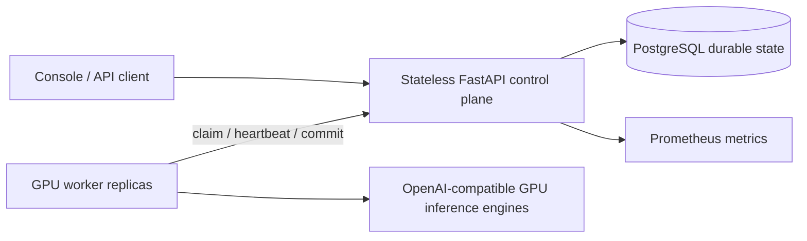

# Architecture and correctness

## Durability

PostgreSQL is the source of truth for input files, batches, tasks, attempts and
usage. A successful submission commits the task set transactionally. Workers
claim bounded sets of available tasks with `FOR UPDATE SKIP LOCKED`.
Multiple API/worker processes coordinate through the same database.

## Execution and result acceptance

A network failure can happen after GPU execution but before result submission.
Physical inference is therefore at least once. Each claim has an attempt token
and a lease. Committing a response requires the current worker, token and valid
lease. Replaying an accepted completion is idempotent; a superseded or cancelled
attempt is rejected. Usage commits in the same transaction as the accepted
result, preventing duplicate accounting.

Expired work becomes eligible again with a bounded retry budget. Cancellation
prevents new claims and fences outstanding attempts. In-flight GPU execution
may consume compute until the engine request is cancelled or finishes.

## Admission and scheduling

Workers claim tasks only for their configured model and available execution
capacity. Concurrency and context reservations bound outstanding inference.
Database claim/recovery work must remain bounded and indexed. Request-size,
upload-size, batch-size and output-token caps are enforced by the control plane.
See implementation and validation for current fairness behavior and limits.

## Isolation

Public resource reads and writes are tenant scoped. API keys are hashed before
storage. Internal worker calls require a separate shared token. Workers are
trusted infrastructure: this token grants access to queued inference inputs.
Production deployments should isolate internal routes with network policy and
rotate the token.

## Scaling boundaries

One PostgreSQL deployment is the first release's durability and coordination
boundary. This is not a multi-region consensus implementation. Large JSONL
files and retention eventually belong in object storage; task tables eventually
need partitioning and archival. Measure database I/O, lock contention, claim
latency and GPU utilization before introducing a second queue system.
Per-batch counter contention and recovery traffic must be included in scale tests.

## Evidence

Correctness under duplicate requests, worker loss, cancellation races and stale
results is tested independently of throughput. Performance reports must include
workload, hardware, model revision, input/output lengths and latency distribution.
Queue acceptance rate and completed GPU work are different metrics.
