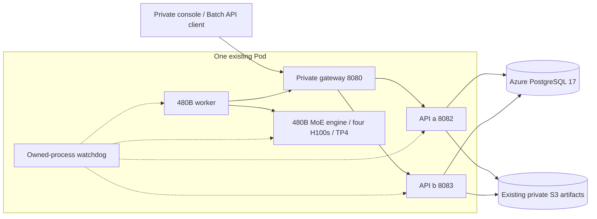

# Architecture and correctness

## Current deployment: October 25, 2026

The active deployment is **one existing four-H100 Pod**, two API replicas, a
private gateway and a TP4 Qwen3-Coder-480B-A35B AWQ engine. Azure PostgreSQL 17
stores the task/attempt/accounting ledger; the existing S3 HTTPS interface stores
inputs and verified result archives. The former second Pod is unavailable.

The [480B qualification](benchmarks/platform480-2026-10-25.md) contains actual
API tasks, acceptance fencing, storage readback and process-fault evidence. The
[quality/endurance campaign](benchmarks/quality-squad-2026-10-25.md) records its
own workload, versions, failures and deployment state. The execution-evidence
API rollout passed at 13:59:37 UTC on October 25; the primary uses immutable
source `398db6f` for that fixed experiment. After its successful 2,400-task
closure, the quality-evidence and stronger-receipt API release `831b839`
published at 15:20:51 UTC. GPU worker/engine identities remained unchanged;
the separate reusable-input endurance then began against that primary.
Historical two-Pod tests remain in [100B validation](100b-validation.md).

## Durability

PostgreSQL is the source of truth for file metadata, batches, tasks, attempts and
accepted usage. Input bytes use S3; completed result bodies can move from the
database to verified immutable archives while retaining ledger identities.
A successful submission commits the task set transactionally. Workers
claim bounded sets of available tasks with `FOR UPDATE SKIP LOCKED`.
Multiple API/worker processes coordinate through the same database.

The active Pod runs two API processes and a health-aware loopback gateway. The
gateway streams responses and forwards a mutation once; a lost response is not
permission to replay an uncertain POST against another API. Workers may switch
configured origins for their next request, retaining the same completion fence
when acknowledgement is uncertain. GPU serving does not require an operator laptop
relay to reach the database. Private client ingress still depends on an operator
SSH path; public ingress was explicitly deferred.

API startup verifies a checksum-protected migration ledger and performs no DDL
or key bootstrap. The owner runs additive migrations separately. Runtime roles
cannot create schema objects or administer tenant keys. Compatible replicas can
run against v1 before migration v2 and then opt into its SQL execution path.

## Execution and result acceptance

A network failure can happen after GPU execution but before result submission.
Physical inference is therefore at least once. Each claim has an attempt token
and a lease. Committing a response requires the current worker, token and valid
lease. Replaying an accepted completion is idempotent; a superseded or cancelled
attempt is rejected. Usage commits in the same transaction as the accepted
result, preventing duplicate accounting.

The optional v2 completion and heartbeat functions execute their whole critical
section in one database call. They run as SECURITY INVOKER with the same table
permissions, lock worker then tenant queue then batch then task, and evaluate
the database clock after waiting for locks. A replay of an already accepted
worker/token remains duplicate-safe after a batch becomes terminal. Completion
also creates terminal output/error file metadata atomically. The Python path
remains available for a controlled comparison and feature rollback; rolling back
the feature flag does not undo the additive migration.

Additive v3 moves claiming into the same single-call form, with a separate flag.
It locks the worker before checking active capacity, materializes at most eight
oldest ready tenant queues with SKIP LOCKED, selects a live batch and bounded task
rows, creates fresh attempts, and updates batch/queue counters in one statement
transaction. A failed attempt insertion rolls back the entire claim. The Python
path remains supported for compatibility and controlled comparison. Enabling
the claim flag requires schema v3 on every serving replica's known ledger prefix.

Expired work becomes eligible again with a bounded retry budget. Cancellation
prevents new claims and fences outstanding attempts. In-flight GPU execution
may consume compute until the engine request is cancelled or finishes.

## Admission and scheduling

Workers claim tasks only for their configured model and available execution
capacity. Concurrency and context reservations bound outstanding inference.
Database claim/recovery work must remain bounded and indexed. Request-size,
upload-size, batch-size and output-token caps are enforced by the control plane.
See implementation and validation for current fairness behavior and limits.

## Isolation

Public resource reads and writes are tenant scoped. API keys are hashed before
storage. Internal worker calls require a separate shared token. Workers are
trusted infrastructure: this token grants access to queued inference inputs.
Production deployments should isolate internal routes with network policy and
rotate the token.

## Scaling boundaries

One managed PostgreSQL deployment is the durability and coordination boundary.
Current application traffic uses Azure; the exhausted historical Neon SQL quota
is not the current serving database. Provider HA/SLA and current monetary cost
have not been qualified by this campaign. Application replicas and
local process watchdogs do not replace database recovery, whole-Pod replacement
or independent client ingress. This is not a multi-region consensus
implementation. Input/result bytes already use S3 with bounded leases and
verified publication. Task/attempt history and physical heap/TOAST/index/WAL
growth still need measured retention and scaling. Measure database I/O, lock contention, claim
latency and GPU utilization before introducing a second queue system.
Per-batch counter contention and recovery traffic must be included in scale tests.
See [capacity analysis](scaling.md) for the daily target and measurement limits.

## Evidence

The [execution receipt API](execution-evidence.md) reconciles batch/task counters
and accepted attempts from one MVCC statement snapshot. Its domain-separated
SHA-256 detects altered exports; independent streaming readback verifies artifact
bytes separately. Neither mechanism proves hardware attestation or model answer
quality. Retired history is explicitly incomplete. Worker registration counts
and claim slots must not be presented as physical GPU inventory.

Correctness under duplicate requests, worker loss, cancellation races and stale
results is tested independently of throughput. Performance reports must include
workload, hardware, model revision, input/output lengths and latency distribution.
Queue acceptance rate and completed GPU work are different metrics.
