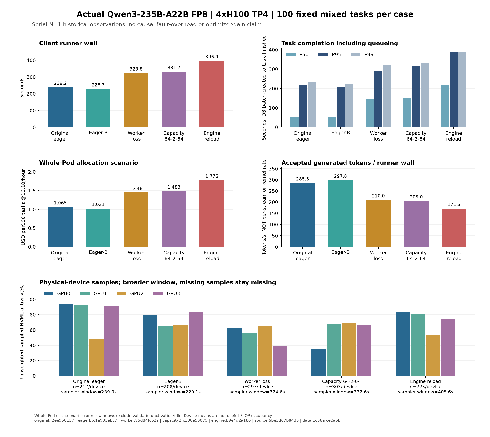

# Actual eager references and controlled fault observations

The two no-fault eager runs and three earlier controlled fault runs each completed **100 real fixed-output mixed tasks**, with zero task failures, on one four-H100 Pod. These are serial N=1 observations, with different process generations and unpaired warm states. The table is descriptive: it does not estimate causal fault overhead or an optimizer gain.

|Observed cohort|Runner wall(s)|Completed tasks/s|DB completionP50/P95/P99(s)|Allocation$/100 at16.10/h|Expired/total attempts|
|---|---:|---:|---:|---:|---:|
|Original eager reference|238.212715|0.419793|55.332/215.794/234.992|$1.065340|0/100|
|Eager-B|228.325327|0.437972|53.106/208.336/225.559|$1.021122|0/100|
|Worker loss|323.839117|0.308795|147.160/292.518/321.921|$1.448280|64/164|
|Admission64→2→64|331.671180|0.301503|151.028/313.393/329.874|$1.483307|64/164|
|Engine reload|396.904711|0.251950|216.611/388.225/388.920|$1.775046|64/164|

All five mixed runs used one batch, the same20-cell input128/512/2048/8192/16384 × output32/128/512/2048 fixture repeated five times,545,280 accepted prompt tokens and68,000 accepted generated tokens. Every task had one durable accepted result. The no-fault cohorts had100 total accepted attempts; each fault cohort had64 expired attempts and164 total attempt decisions. Inference may execute more than once after a fault; this is not exactly-once GPU execution.

The original eager reference is the fresh one-batch measurement, replacing the earlier five-batch result as a descriptive reference. Its declared146-file serving-source map, schema11 ledger, configuration SHA map and static16-derived scheduling profile equal those recorded by all three historical fault plans. This checks declared controls, not the equivalence of runtime warm state or fault interventions. The original reference was measured after the three faults and intervening work; worker/capacity tests retained an engine, while the engine test reloaded it. API, worker and engine generations were not independently randomized or paired. Prefix caching was disabled, but allocator/kernel/model warm state was not matched.

Eager-B was separately activated with eager execution and the same298,384 shared-token budget/64 claimed-task limit on all four GPUs. Fresh usable-KV evidence reported314,096 physical cache tokens. Its146-file serving-source map and schema equal the original reference, but its managed manifest/engine-worker env files and source-bound runtime fingerprint differ: original`62fdcd18…`, eager-B`49f0ed87…`. The parent static16 rates and per-slot proxy price remain projected and unchanged. The roughly10-second wall difference between these two single runs is compatible with uncontrolled run variation; it is not evidence of an algorithmic improvement. No confidence interval, repeated randomized trial or heterogeneous-hardware result is available.

The allocation column is whole-Pod16.10USD/hour × each runner wall/3600, including the deliberate outage/recovery/retries inside the fault runner. It excludes output validation, quality evaluation, wrapper checks, activation/recovery outside that runner and idle time. It is not a current invoice, marginal cost, full experiment allocation or daily capacity forecast. Generated-token rates in the chart divide accepted output tokens by this same runner wall; they are not per-stream decode or GPU kernel rates.

Task percentiles are DB batch-created→task-finished across all100 tasks, including queueing. They are not client scheduled-arrival percentiles, isolated model service latency or TTFT. Fault lease/model-load/unavailability intervals have their own boundaries and overlap; the [worker](qwen235b-worker-fault100-2026-10-24.md), [capacity](qwen235b-capacity2-fault100-2026-10-24.md) and [engine](qwen235b-engine-fault100-2026-10-24.md) reports preserve those detailed recovery/fencing observations. They must not be added together or subtracted from runner time to claim pure inference work.

The chart also preserves all four physical-device NVML means and per-device observation counts. Sampling windows include output validation and differ from runner windows. In the engine-fault run there were378 sampler iterations but only225 valid observations per device; missing samples are not filled with zero. Uneven rank activity, including original GPU2's48.9% mean, is shown as observed and is not sustained occupancy, useful FLOPs or exclusive workload attribution. No hardware reset, independent Pod failover or cross-node migration is established.

Both no-fault operations additionally ran the same100-example natural-output public QA fixture, without fixed output length. These quality results are separate from the fixed mixed workload:

|QA cohort|Runner wall(s)|Generated tokens|JSON contract rate|Truncated|Answer EM|Answer tokenF1|
|---|---:|---:|---:|---:|---:|---:|
|Original eager reference|12.638972|1414|1.00|0|0.80|0.907627202|
|Eager-B|12.740721|1392|1.00|0|0.79|0.902726301|

Observed QA quality changed slightly between the two runs; it is not forced to historical values. Both used113,028 accepted input tokens,100 unique outputs, no missing/unknown/duplicate outputs and the same evaluator v2. These are not official SQuAD scores, and public examples may be training-contaminated. No translation, grounding or explanation-quality claim is made. The model is Qwen3-235B-A22B-Instruct-2507-FP8, approximately22B active MoE parameters per token rather than a dense235B model.

The26 exact original metadata files are copied byte-for-byte under the [source-origin inventory](../../ops/reports/qwen235b-eager-and-fault-observations-2026-10-24-source-origin.json). Root privately transported only the13 allowlisted metadata files per no-fault operation, with external SHA anchors. Full validation ran the unchanged517 original parser and bfdb18 V3 eager-B parser, including journal/source/profile/custom-ID/usage crosslinks and exact0a recomputation of four same-worker histogram snapshots into two deltas. Those stage histograms overlap tasks and are neither durable per-attempt traces nor proof of CUDA graph replay. Configured-unstarted profiler receipts describe operator attestation, not direct in-memory profiler state. Raw questions, golds, generated text, credentials, env/effective snapshots, logs, traces and database dumps are excluded.

The [numeric dataset](../../ops/reports/qwen235b-eager-and-fault-observations-2026-10-24.json) and [chart audit](qwen235b-eager-and-fault-observations-2026-10-24-chart-audit.json) bind every source and rendered artifact SHA. The standalone analysis source is preserved as text in the inventory. Local packaging performed no production query, inference, restart or source deployment. No successful graph cohort or replay result is included.

Original benchmark SHA anchors:

- [Original eager reference benchmark](../../ops/reports/qwen235b-original-eager-cohorts-v1-mixed-report-2026-10-24.json) — `f2ee958137418c1f0c5db4d450eb621a5269f0bbf267cb43165a19dfb24a1650`.
- [Eager-B benchmark](../../ops/reports/qwen235b-eager-b-cohorts-v1-mixed-report-2026-10-24.json) — `c1a933ebc7a6413a5add853e9b8fbbcf94651a005ca915c232e4ba60e5d5eb16`.
- [Worker loss benchmark](../../ops/reports/qwen235b-worker-fault100-v1-benchmark-2026-10-24.json) — `95d84fcb2aa48740125c1729cd1c4023cab7d8c5100cc851b0460aa39b657b93`.
- [Admission64→2→64 benchmark](../../ops/reports/qwen235b-capacity2-fault100-v1-benchmark-2026-10-24.json) — `c138e5007581d13cec51ff3863f2172af2ef49c7593f8656c9ae6ebb8ceedfba`.
- [Engine reload benchmark](../../ops/reports/qwen235b-engine-fault100-v1-benchmark-2026-10-24.json) — `b9e4d2a186746c6a32ae2b24167b11fdd30b0e73f60f4d94952bd08d2e410b12`.
