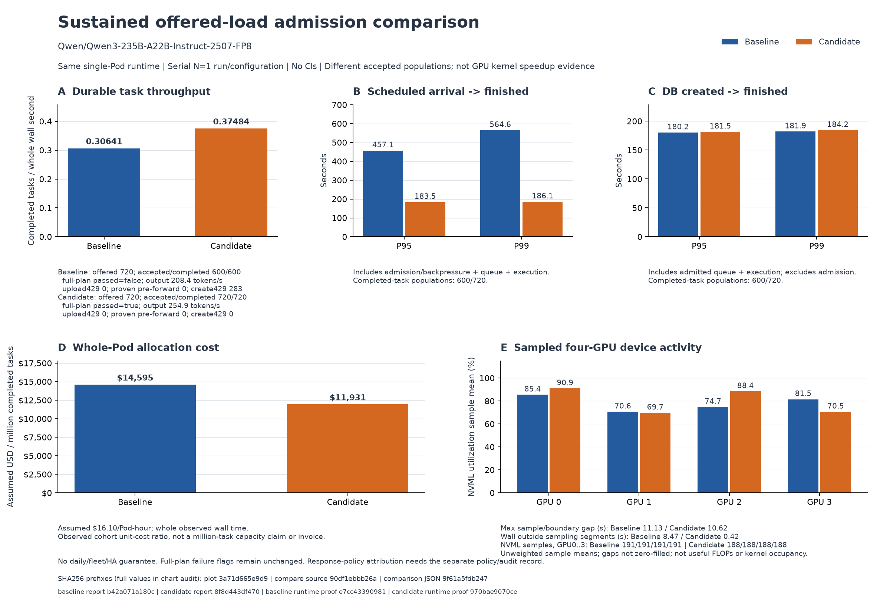

# Qwen235B response-reservation experiment

With the same four-H100 Pod and Qwen3-235B-A22B-Instruct-2507-FP8 runtime, reducing the **future-task response reservation from 1MiB to 64KiB** increased observed whole-run completion throughput by **22.3%** and reduced assumed allocation cost per completed task by **18.3%**. The improvement appears in admission/backpressure: admitted-task P95/P99 completion time did not improve. This is one serial run per policy, with different completed populations, so it is descriptive evidence for this offered-load experiment.

Both runs used schema11, the same source/env/PIDs and runtime fingerprint, the same fixed-token 20-cell fixture, 720 offered tasks at 0.4 tasks/s over a 30-minute admission window, batches of 20 and at most 80 inflight tasks. The model is a 235B-parameter MoE with about 22B active parameters per token; these results do not describe dense-235B execution. The recorded policy intervention changed only the future response cap; task quota stayed 50,000, aggregate payload quota 320MiB and error reservation 32KiB. Existing task limits stayed immutable. The same automatic archive/purge policy applied, and both rounds began with the same legacy charged payload, 205,935,962 bytes. Retained task and auxiliary-history counts grew between rounds and were recorded rather than reset.

| Observed metric | 1MiB baseline | 64KiB candidate |
| --- | ---: | ---: |
| Offered tasks | 720 | 720 |
| Accepted / completed | 600 / 600 | 720 / 720 |
| Original full-plan `passed` | **false** | **true** |
| Create-429 responses, including retries | 283 | 0 |
| Failed accepted tasks / uncertain creates | 0 / 0 | 0 / 0 |
| Output tokens | 408,000 | 489,600 |
| Runner wall seconds | 1,958.152 | 1,920.824 |
| Completed tasks / runner wall second | 0.30641 | 0.37484 |
| Output tokens / runner wall second | 208.36 | 254.89 |
| Scheduled arrival → admission, batch P95 / P99 seconds | 362.365 / 423.964 | 2.642 / 2.775 |
| Scheduled arrival → finished, task P95 / P99 seconds | 457.133 / 564.628 | 183.500 / 186.060 |
| DB created → finished, task P95 / P99 seconds | 180.191 / 181.905 | 181.503 / 184.206 |
| Assumed runner allocation USD | 8.757291 | 8.590351 |
| Assumed USD / completed task | 0.0145955 | 0.0119310 |

The baseline remains a **partial plan**: all 600 accepted tasks completed, but 120 offered tasks were not admitted within the configured window. Candidate `passed=true` means its configured 720-task plan completed. Both reports verify accepted-once completion, accepted/task token accounting and exact fixed output lengths; this is not a claim of exactly-once GPU execution. No uploaded-response shrinkage produced the gain: the same output-cap fixture was used, and each run's completed population received its exact requested token caps.

The original response-byte audits cover all 600/720 outputs. Their largest PostgreSQL `jsonb::text` response sizes were 13,351/13,690 bytes, leaving at least 52,185/51,846 bytes under 64KiB. This supports the cap for this measured fixture; longer/different response formats require their own bounds. Local review used only metadata and output hashes; raw model outputs remain outside this evidence package.

The large end-to-end tail reduction includes waiting for durable admission. DB-created-to-finished P95 increased about 0.73% and P99 about 1.26%; the chart keeps these intervals separate. Percentiles describe 600 versus 720 completed tasks, while admission percentiles describe 30 versus 36 accepted batches. No confidence interval, randomized comparison, matched-task causal latency claim or GPU kernel speedup is established.

Cost uses an **assumed $16.10 per whole-Pod hour**, including each runner's admission backoff, idle time, drain, validation and disconnect overhead. The two runner windows sum to **3,878.975963 seconds / $17.347643**. The entire terminal parent operation is **4,138.806346 seconds / $18.509662**; its additional **259.830383 seconds / $1.162019** includes controller, collection/audit and inter-round/final cleanup overhead without individual-stage attribution. Preparation, later export/transport, local rendering and later idle time are excluded. These are allocation scenarios, not an invoice, marginal inference cost or a demonstrated million-task capacity.

All four GPUs have actual NVML observations: baseline sample means 85.4%, 70.6%, 74.7%, 81.5%; candidate 90.9%, 69.7%, 88.4%, 70.5%. These are unweighted device-activity samples, not useful FLOPs, Tensor Core occupancy or time-weighted utilization. Maximum sample/boundary gaps are 11.13/10.62 seconds and remain explicit. The results do not establish sustained maximum GPU efficiency, daily capacity, multi-Pod HA or fleet scaling.

Original-byte evidence is indexed by the [source-origin inventory](../../ops/reports/qwen235b-v11-metadata-source-origin-2026-10-24.json): 14 original metadata files, their sizes/SHA256 and original same-Pod paths, plus the unchanged [transport manifest](../../ops/reports/qwen235b-v11-metadata-transport-manifest-2026-10-24.json). Its externally supplied SHA is `c44c19bc2eaca11f831bd8986959d402c18f9bb6691ae76422d4ec5025022132`. The local receive manifest was verified at SHA `205f298a12c76cb9ba75fe9e577471fd0fb40c52deec78c1bdd953acf7d224d7` and is not copied into the repository because it contains local absolute paths. Frozen receiver `5534f19c…` independently reverified both WRITE receipts, all five artifacts per round, terminal parent and comparison. [The chart audit](qwen235b-v11-response-policy-two-30m-2026-10-24.chart-data.audit.json) records numeric inputs, PNG/SVG hashes and the explicit SVG whitespace normalization; PNG and layout were unchanged. No service, source or business state was modified by this local evidence review.
