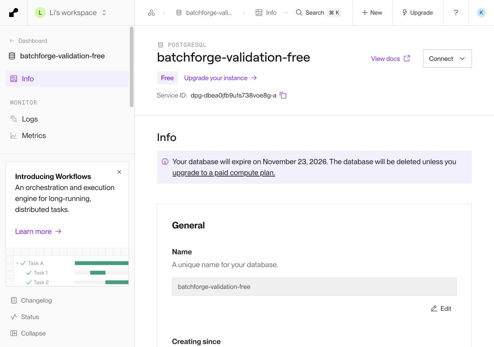
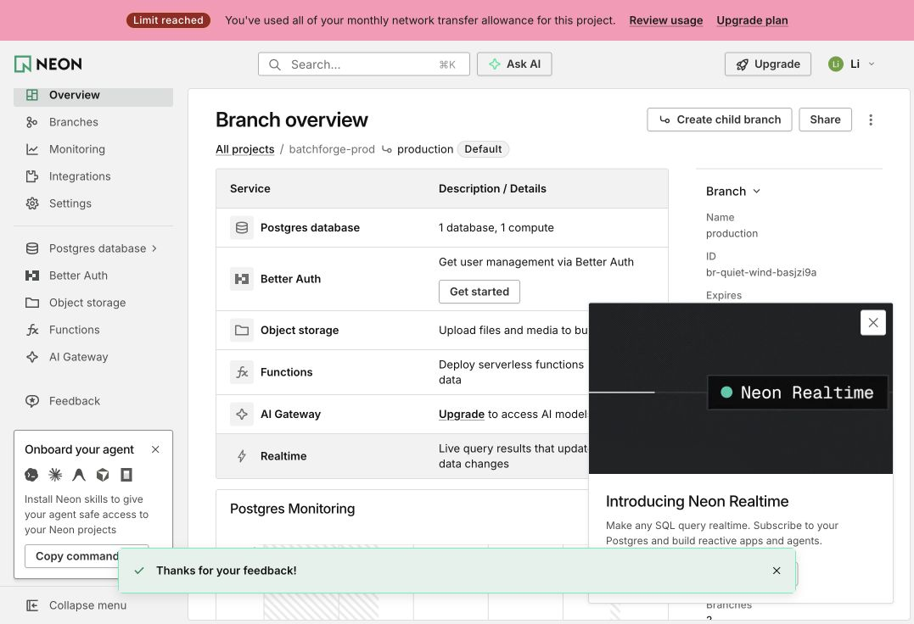

# Free PostgreSQL qualification — October 24, 2026

Render Free PostgreSQL was created through the existing authenticated account
after Aiven signup failed. It is a **temporary validation target**. Neon remains
the authoritative source; no existing data has been imported or promoted and
the serving application configuration has not been switched.

The actual service is `batchforge-validation-free`, Frankfurt, PostgreSQL
17.11. The selected plan is $0/month, 0.1 CPU, 256 MB RAM and 1 GB storage.
The console states that it expires on **November 23, 2026**. Billing showed
Hobby, no payment card, $0 current/projected charges and no datastore charges.
HA, storage autoscaling and the managed connection pool are disabled. This is
not a durable free production/HA solution. See [Render's free-instance
limits](https://render.com/docs/free).

The database-level inbound rule permits only the current GPU Pod's `/32`.
Render documents that rules at different hierarchy levels must all allow a
connection; the workspace's existing broad rule does not override the tighter
database rule. No workspace-wide rules were changed. See [inbound IP
rules](https://render.com/docs/inbound-ip-rules).

## Actual qualification from the GPU Pod

Credentials stay in root-readable files on the Pod. Connections require
`sslmode=verify-full` and the system CA store. The owner is not a superuser and
has CREATEDB/CREATEROLE. A new empty logical qualification database was created
separately from the empty `batchforge` database.

| Check | Actual outcome | Evidence |
| --- | --- | --- |
| Creation and strict TLS | Dedicated empty qualification DB, production configuration unchanged | [Creation](../ops/reports/render-free-database-created-2026-10-24.json) |
| Transport/SQL overhead | 20 samples per class; measurements below | [Latency](../ops/reports/render-free-database-latency-2026-10-24.json) |
| Exact immutable migrations 1–11 | 25 tables, one view, 39 functions; verifier passed; known rollback left zero public tables/views/functions | [DDL rollback](../ops/reports/render-free-schema11-rollback-2026-10-24.json) |
| Runtime SQL privileges | 128 metered execute calls, 19 expected denials; all synthetic structures/data and temporary NOLOGIN role rolled back | [ACL rollback](../ops/reports/render-free-runtime-acl-2026-10-24.json) |

| Latency class | P50 ms | P95 ms | Maximum ms |
| --- | ---: | ---: | ---: |
| Fresh TLS/authenticated connection | 402.523 | 2,115.983 | 2,158.505 |
| Warm `SELECT 1` | 11.283 | 63.912 | 83.758 |
| Read-only BEGIN/SET/SELECT/COMMIT transaction | 45.286 | 83.258 | 131.984 |

These 20-sample measurements do not establish a tail SLO or BatchForge
admission latency. Connection establishment is expensive enough that the
application's bounded persistent pool needs validation. The empty qualification
database was 7,657,139 bytes; that does not prove that current source data plus
indexes, other databases, WAL and operational headroom fit the provider limit.

The 3.498561-second ACL transaction exercised actual cost-aware claim,
heartbeat, complete, duplicate complete, lease recovery, a fresh attempt token,
stale-token rejection and terminal failure. Accepted accounting remained one
completion with seven input/three output tokens and one failed task. Five
private SECURITY DEFINER helpers denied direct execution to PUBLIC and runtime;
all expected quota/admin/DDL/history/counter restrictions held. This used
`SET LOCAL ROLE`, not a separately authenticated runtime connection, and every
write rolled back. **Authenticated runtime LOGIN and committed durability are
separate remaining gates.**

## Current source and migration boundary

The Neon console specifically reports that the project's monthly network
transfer allowance is exhausted. SQL connections are rejected. The displayed
usage was 6.62 GB network transfer, 4.88 CU-hours, 393.08 MB storage and 204.11 MB
history. The console's existing snapshot has no download action. No restore,
deletion, new quota-evading project/branch, plan upgrade or card was used.

With explicit user authorization, a one-time free read-only export request was
submitted through the authenticated Neon console's official feedback form.
The UI displayed **“Thanks for your feedback!”**. Free accounts expose community
and AI support rather than an individual support-ticket form, so this is a
confirmed feedback submission, **not a numbered ticket or an approved export
window**. [Submission metadata](../ops/reports/neon-free-export-request-2026-10-24.json)
contains the exact request and scope.

The earlier same-Pod backup predates later benchmark and failure records. It
must not be promoted as the latest complete source. Migration still requires a
fresh consistent export, full schema/data/constraints/trigger/ACL verification,
application-level conservation and replay tests, capacity/headroom validation,
and a reversible cutover. New synthetic testing on Render cannot establish a
lossless migration of the old Neon database.

## GPU work while the source is unavailable

A real cold-first 20-cell direct-engine diagnostic completed on all four H100s
with the existing official Qwen3-235B-A22B-Instruct-2507-FP8 checkpoint. It is
recorded independently in [the engine diagnostic report](qwen235b-engine-diagnostics-2026-10-24.md).
These are not new durable BatchForge task completions.
