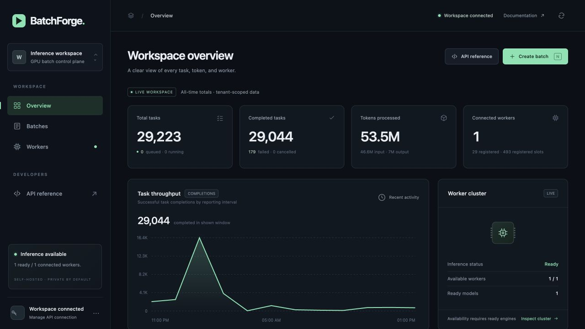
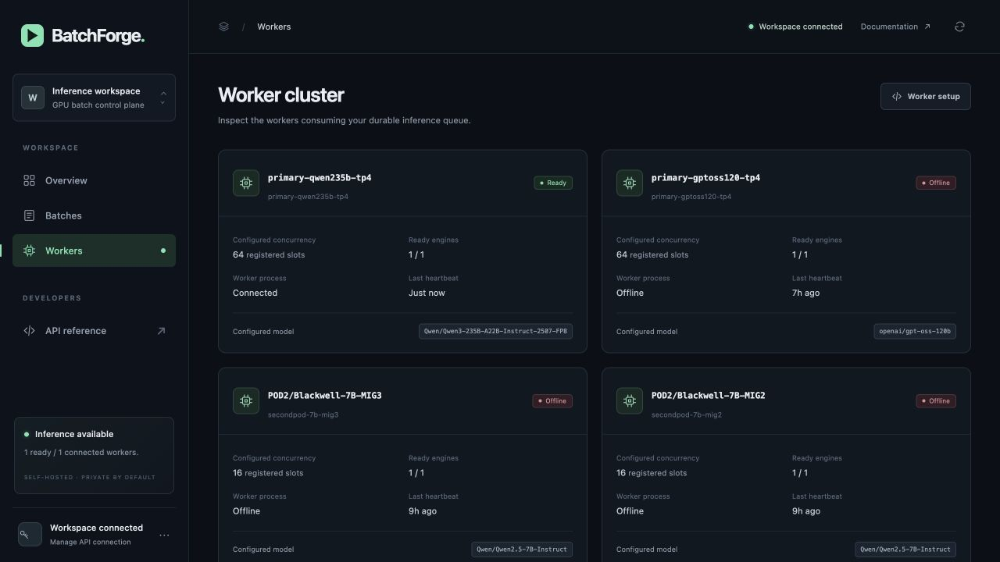

# Actual private console captures

These screenshots show the authenticated, private BatchForge workspace on 2026-10-24. They are original browser captures, without data substitution or image editing. The API key entry dialog is closed and no credentials, prompts or generated answers are shown. Capture bytes and timestamps are recorded in the [origin inventory](../ops/reports/qwen235b-live-console-screenshot-origin-2026-10-24.json).

The overview reports 29,223 historical tasks, 29,044 completed, 179 failed and about 53.5 million tokens across earlier experiments. Those historical failures are separate from the new response-policy comparison, whose accepted tasks all completed. These all-time counters are not a throughput or daily-capacity measurement.

The available worker is `primary-qwen235b-tp4`, configured for 64 concurrent tasks and Qwen3-235B-A22B-Instruct-2507-FP8. It uses four H100s as one tensor-parallel serving group. Other registered workers shown as offline are historical records, including the unavailable second Pod. Registered slot totals and historical engine-readiness fields do not establish current available capacity. GPU activity and benchmark evidence are recorded separately in the [real sustained comparison](benchmarks/qwen235b-v11-response-policy-results-2026-10-24.md).

The captures precede the later worker source rollout. The temporary browser tab was closed afterward so its automatic refresh would not add polling traffic to subsequent experiments. The operator accesses this private console through an SSH tunnel; the running services do not depend on that laptop connection. One-Pod compute failure recovery and independent compute high availability are different claims; these screenshots establish neither whole-Pod failover nor cross-node migration.
