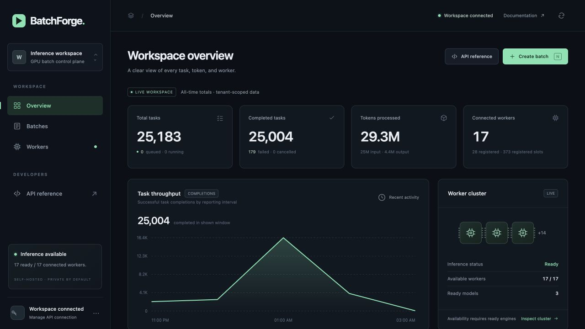
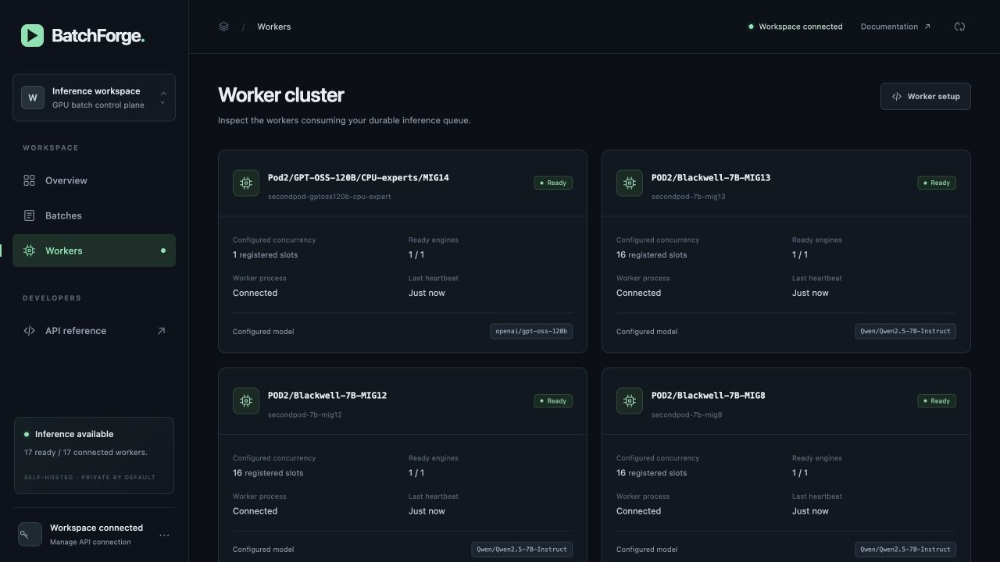
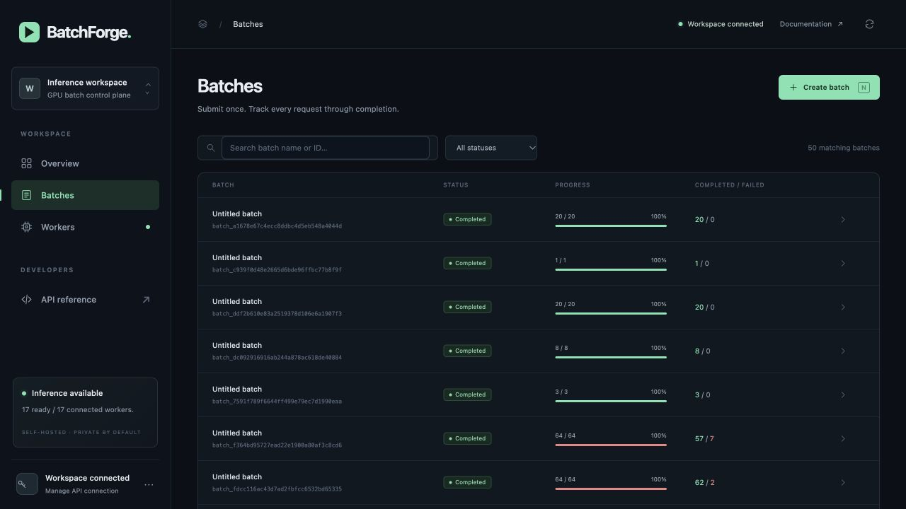
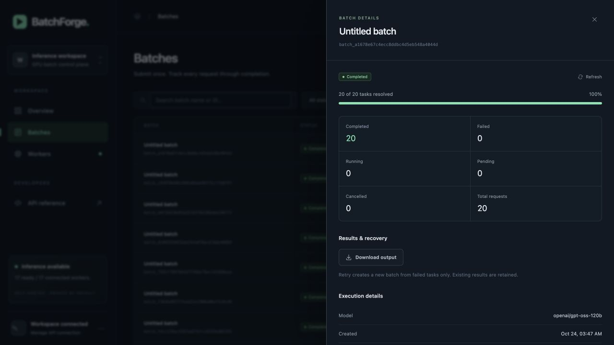
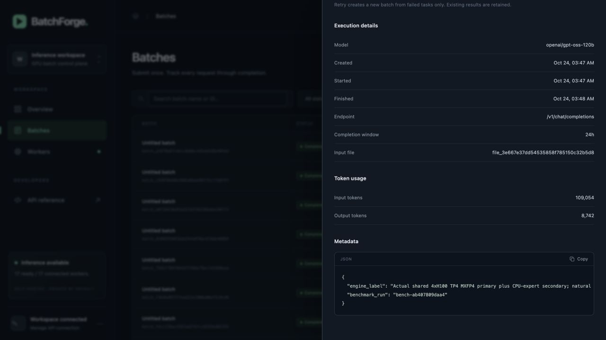

# BatchForge platform screenshots

Current October 25 services use Azure and a 480B-total / 35B-active MoE. These
October 24 images are historical; no current 480B visual QA is claimed. See the
[current runbook](../operations.md).

## Historical single-Pod Qwen3-235B deployment

These unedited screenshots were captured from the running private console on
October 24, 2026, around 08:19 Asia/Dubai (04:19 UTC), after the final 100-task
capacity run and 20-task public-gold QA/archive validation. Capturing them
submitted no inference. No credential form or raw task output is shown.

The overview shows 26,943 historical tasks, 26,764 completed, 179 failed,
39.9M processed tokens and one connected worker. The chart shows completions
by reporting interval, not requests per second. Its 29 registered workers and
493 registered slots include old experiments; they are not current capacity.

The then-serving `primary-qwen235b-tp4` worker is ready with one engine serving
`Qwen/Qwen3-235B-A22B-Instruct-2507-FP8` across four H100 GPUs. Its 64 configured
slots are a claim limit controlled by a 298,384-token reservation budget;
this does not promise 64 simultaneous full 18K contexts. Offline 120B and
second-Pod registrations remain visible as historical records. Their stale
engine counters do not establish availability. Worker readiness is not GPU
utilization. The [validation report](../single-pod-validation-2026-10-24.md)
contains the measured throughput and separate gold-answer quality checks.

## Historical two-Pod 120B deployment

The following five screenshots are preserved evidence from the earlier
deployment. They do **not** describe the current number of live Pods or workers.

These unedited screenshots were captured from the running private deployment
on October 24, 2026, around 04:35 Asia/Dubai. They show existing persisted
workload results; taking the screenshots did not submit any new inference.

## Workspace overview

25,183 total tasks, 25,004 completed, 29.3M processed tokens, and 17 connected
workers. Totals include earlier models, experiments and 179 historical failed
tasks. The throughput chart shows completions by reporting interval, not RPS.
Registered workers and slots include historical registrations; they are not
the same as currently available inference capacity.

## Worker cluster

The visible second-Pod GPT-OSS-120B worker is ready with one configured slot.
Other visible cards serve Qwen2.5-7B. The sidebar reports 17 ready workers
across the deployment. Worker readiness does not measure GPU utilization.

## Batch history

The recent 20-request comparisons, one-request smoke test and eight-request
recovery exercise are visible. Older batches may have terminal failures;
the completed/failed column remains visible rather than hiding those runs.

## Completed 120B batch

Batch `batch_a1678e67c4ecc8ddbc4d5eb548a4044d` completed 20/20 tasks, with
zero failed, running, pending or cancelled tasks. Its model is
`openai/gpt-oss-120b`. Durable completion does not establish answer correctness.

## Actual token usage

The same batch records 109,054 input and 8,742 generated tokens. It explicitly
requested low reasoning effort; generated usage can include reasoning tokens.
See the [validation report](../100b-validation.md) for final-text presence,
length caps, quality limitations and worker attribution.

