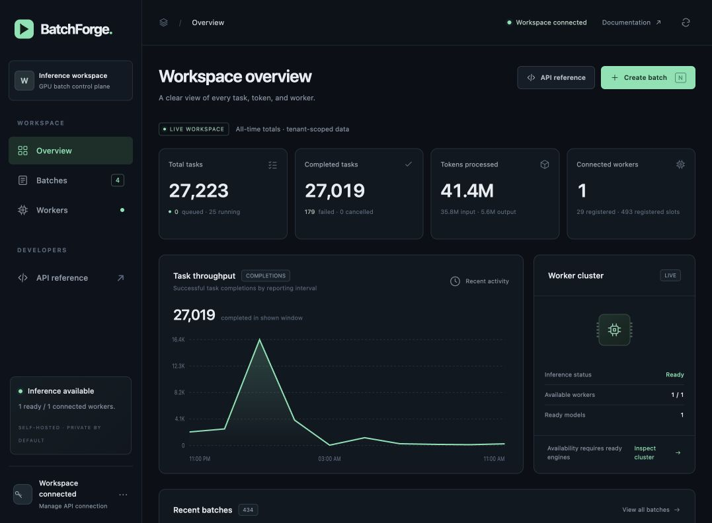

# Sustained-load overview screenshot

Captured from the actual authenticated private console at
`http://127.0.0.1:8787/` during the first 30-minute Qwen235B sustained-load
window. The browser operation only loaded the overview; it submitted no
inference, batch, maintenance, or configuration request.

- Capture UTC: **2026-10-24T07:22:59.978Z**.
- Dubai local time: **October 24, 2026, 11:22:59.978 AM (UTC+4)**.
- File: [qwen235b-sustained-load-2026-10-24.jpg](qwen235b-sustained-load-2026-10-24.jpg).
- Encoding: actual JPEG, verified `FF D8` magic; 64,199 bytes, 1,077 × 792 pixels.
- SHA256: `a64e01e774b759b9905510f95000f13481c26e68e1f682be101c2db81deb0aaf`.

The screenshot visibly shows these **workspace all-time totals**, not isolated
results for the current soak cohort:

| Visible field | Value |
| --- | ---: |
| Total tasks | 27,223 |
| Queued / running | 0 / 25 |
| Completed tasks | 27,019 |
| Historical failed / cancelled | 179 / 0 |
| Tokens processed | 41.4M |
| Input / output tokens | 35.8M / 5.6M |
| Connected workers | 1 |
| Ready / connected workers | 1 / 1 |
| Ready models | 1 |
| Batches navigation badge | 4 |
| Recent batches total | 434 |

The small text also lists 29 registered workers and 493 registered slots.
Those are historical registrations, not 29 online workers or 493 live GPU
execution slots. The cluster panel reports **Ready** and one available worker.
The viewport ends near the recent-batches header; individual batch rows are
not shown in this image.

The image was visually reviewed after saving. It contains aggregate platform
counts and interface labels, with no API key, credential dialog, prompt text,
generated answer text, or raw logs visible. No image editing or synthetic data
was used. The all-time failed count must not be attributed to the active soak;
its acceptance, HTTP429 and completion statistics belong in the run's separate
benchmark evidence.

